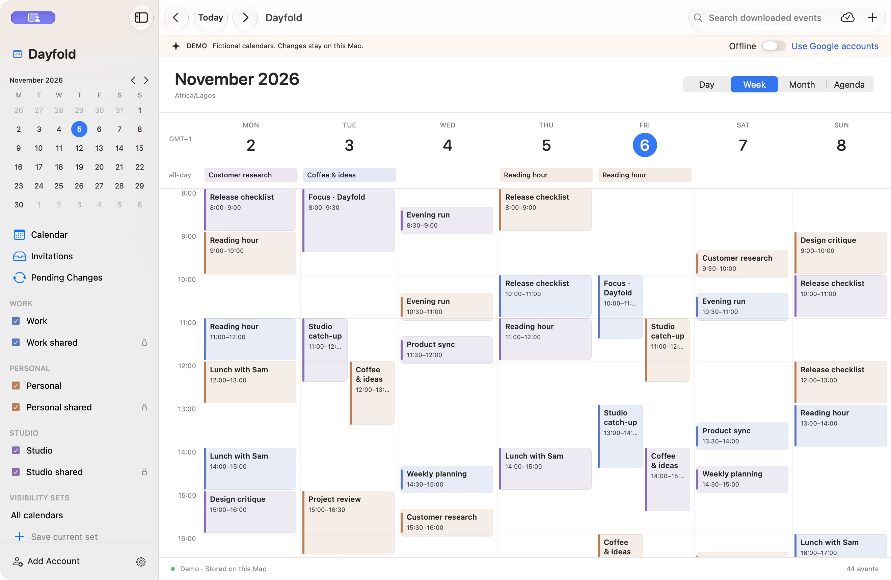

# Dayfold

A native macOS calendar window and menu bar companion for multiple independent Google accounts. The implementation follows [NativeCalendar_Agent_Brief.md](NativeCalendar_Agent_Brief.md), using SwiftUI, a testable CalendarCore package, GRDB/SQLite, AppAuth, and Keychain.

```sh
./script/build_and_run.sh
```

Choose **Explore Demo**, or run `./script/build_and_run.sh --demo`. Demo events are fictional and use a separate database and local fake provider. They are never uploaded to Google.

This is a working development build. The M00–M11 implementation is present, with passing core/platform regression suites, a separately exercised large-data benchmark, and manual checks of the real app. Core is **not yet verified for beta**: live Google operations and several platform acceptance checks remain unverified. See [implementation status](docs/implementation-status.md), [current verification results](docs/verification.md) and the [complete acceptance map](docs/acceptance.md).

Dayfold account sign-in, device enrollment and expiring/rotating credentials are implemented with OIDC and DPoP; see the [authentication setup](docs/authentication.md). Public release still requires real identity-provider acceptance, push-destination possession checks, signed distribution and the [production security requirements](docs/security.md). Legacy operator tokens are restricted to explicit local development.

Implemented surfaces include day/week/month/agenda, account/calendar visibility, event details/editor, durable drafts and writes, invitations, conflict review, quick entry, local search, recovery export, settings, and the menu bar companion. Google authorization and REST synchronization are implemented; a Desktop OAuth client and user-authorized disposable calendars are required for live verification.

## Choose your workspace

Use **Calendar** to browse and edit directly, or choose **With an assistant** during setup or in **Settings → General**. The assistant workspace pairs requests and suggested plans with a real day preview; the full calendar is always available.

The assistant connects directly to OpenAI using your own API key, stored in Keychain separately for demo and Google calendars. It can read downloaded schedules, find time within reliably cached calendars and prepare one new event. **Review Event** opens a local draft; you approve the final change in the normal editor. Requests and relevant event titles/times are sent to OpenAI, and API usage is billed to your OpenAI account. Selecting the mode or saving a key does not send a request. See [Privacy](docs/privacy.md) and [assistant limits](docs/limitations.md#optional-assistant). Live model responses have not been verified without a configured user key.

The optional [Rust notification backend](backend/README.md) connects through **Settings → Real-time**. The native client handles account/device sessions, watch renewal, authenticated live streams, durable replay and reminder coordination. Public APNs registration remains disabled until push-destination possession is verified. [Native setup](docs/relay.md) explains the public HTTPS endpoint and provisioned push build required for real Google/APNs delivery. Local sync and notifications remain available without the relay.

- [Setup](docs/setup.md)
- [Architecture](docs/architecture.md)
- [Notification backend setup and protocol](backend/README.md)
- [Limitations](docs/limitations.md)
- [Privacy](docs/privacy.md)
- [Security model and public-release requirements](docs/security.md)
- [Release preparation](docs/release.md)
- [Engineering decisions](docs/decisions.md)
- [Verification, performance, and manual evidence](docs/verification.md)

Run deterministic checks with `./script/test.sh`. A universal ad hoc archive can be built with `./script/archive.sh --local`; it is not notarized. `./script/test.sh --ui` also attempts the macOS UI test target; the current host's Developer Mode is disabled and its UI automation runner has not initialized successfully. The owner chose to retain those permissions and continue manual checks.

## Real app screenshots

These captures contain fictional demo data only.



[Month](docs/screenshots/month.png) · [Agenda](docs/screenshots/agenda.png) · [Editor](docs/screenshots/editor.png) · [Quick entry](docs/screenshots/quick-entry.png) · [Account settings](docs/screenshots/accounts.png) · [Conflict review](docs/screenshots/conflict.png)
